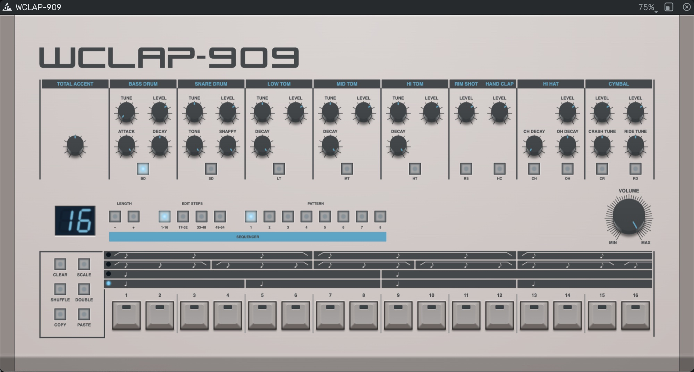

### Disclaimer
_**The use of any trade name or trademark is for identification and educational purposes only and does not imply any association with the trademark holder of their product brand.**_

### WC-909
A drum machine modelled after the [Roland TR-909](https://en.wikipedia.org/wiki/Roland_TR-909) as a
[WebCLAP](https://github.com/WebCLAP) plugin: a minimal sequencer unit that plays the ten 909 instruments. The DSP is written in AssemblyScript and compiled to a CLAP
`module.wasm`, the panel is the plugin's webview page.

- Select the instrument to edit with the keys below the instrument sections, then toggle its steps with the 16 step keys
  (none → weak → full for instruments with two levels).
- 8 patterns of up to 64 steps, selected with the PATTERN keys. While the host plays, the selection waits for the end of
  the running pattern.
- EDIT STEPS chooses which 16 steps the step keys show (1-16 ... 49-64). The range the pattern plays in flashes.
- LENGTH shows the pattern length, − and + change it (hold to repeat).
- SCALE cycles the scale, CLEAR clears the selected instrument.
- Tempo and play/stop come from the host's transport. Notes (General MIDI drum map) play the instruments.

### Layout

    dsp/assembly/       the plugin (AssemblyScript): CLAP entry, params, state, ports, gui/webview, voices, sequencer
    dsp/resources/      the samples, embedded into module.wasm by scripts/build-dsp.mjs
    ui/index.html       the webview page (the plugin's GUI), src/ holds its code
    index.html, host/   a WebCLAP test host: runs module.wasm in an AudioWorklet, shows the page in its plugin
                        window, relays messages, with transport, drum pads, parameters, state and a message log

The test host is adapted from the one in juce-webclap-plugins. The page and the plugin talk through the WebCLAP
webview channel in binary frames, see `dsp/assembly/protocol.ts`.

### Credits
Thanks to [Sascha Kaltenschnee](https://soundcloud.com/cyberpvnk) for lending me his [DinSync RE-909](https://www.kumptronics.com/shop/electronic-instruments/), which is an exact hardware copy of the original [TR-909](https://en.wikipedia.org/wiki/Roland_TR-909).

Logo SVGs (Roland, TR-909 & Rhythm Composer) by [Isaac Cotec](https://subaqueous.gumroad.com/l/hmOwu?recommended_by=search&_ga=2.213635036.938996232.1655202059-1482949479.1654938206&_gl=1*yr8fvz*_ga*MTQ4Mjk0OTQ3OS4xNjU0OTM4MjA2*_ga_6LJN6D94N6*MTY1NTIwMjA3My4zLjEuMTY1NTIwMjA3OC4w)

### Build
Built with [AssemblyScript](https://www.assemblyscript.org), [Vite](https://vite.dev), Sass and the openDAW UI
libraries (`@opendaw/lib-std`, `lib-dom`, `lib-jsx`).

    npm install
    npm run dev        # test host on http://127.0.0.1:5909, rebuilds module.wasm when dsp/ changes
    npm run build:dsp  # only module.wasm (public/module.wasm)
    npm run build      # dsp, type-check and bundle into dist/ (dist/ is the bundle: module.wasm, ui/)

### License
Copyright (c) 2022 André Michelle. Licensed under the [GNU Affero General Public License v3.0 or later](LICENSE).
